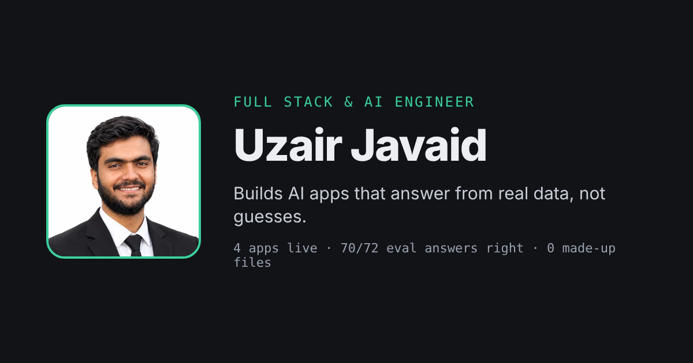

<div align="center">

# Uzair Javaid — Portfolio

**Full stack & AI engineer who builds AI apps that answer from real data, not guesses.**

[**Live site →**](https://uzairjiqbal.github.io) &nbsp;·&nbsp; [Resume](https://uzairjiqbal.github.io/resume.pdf) &nbsp;·&nbsp; [Email](mailto:uzair.j1089@gmail.com)

[](https://github.com/UzairJIqbal/UzairJIqbal.github.io/actions/workflows/deploy.yml)




</div>

---

## Overview

A fast, one-page developer portfolio with a 3D hero and scroll-driven animation, exported as static HTML and deployed to GitHub Pages on every push.

It is built around one rule: **the motion supports the content and never blocks it.** The 3D scene loads after the page, pauses when it is off screen, and every animation is switched off for visitors who prefer reduced motion.

## Features

| Area | What it does |
| --- | --- |
| **3D hero** | A slowly turning graph of connected nodes, with light pulses that walk the edges. It nods to Flowlens, my codebase-mapping project. It follows the pointer and the light/dark theme. |
| **Scroll animation** | Staggered reveals, count-up statistics, self-drawing section rules, a wipe-in GitHub chart, a reading-progress bar and active-section nav highlighting. All of it runs on GSAP and ScrollTrigger. |
| **3D tilt cards** | Project cards and the profile photo tilt toward the cursor, with layered depth and a cursor-following highlight. |
| **Live status box** | Pings each deployed app from the visitor's browser and shows response time. |
| **Dark mode** | Theme toggle with no flash on load; the 3D scene recolours live. |
| **Content in one file** | Every word on the site lives in [`src/data/site.ts`](src/data/site.ts). |

## Tech stack

- **Framework:** Next.js 15 (App Router, static export), React 19, TypeScript
- **3D:** Three.js via React Three Fiber, using instanced meshes for the nodes and pulses
- **Animation:** GSAP 3 + ScrollTrigger (`@gsap/react` `useGSAP` for cleanup)
- **Styling:** Tailwind CSS 4 with CSS-variable design tokens
- **CI/CD:** GitHub Actions, then GitHub Pages

## Performance & accessibility

- **Small first load (~114 kB JS).** Three.js is split into its own chunk and loaded only in the browser, after the page is interactive.
- **No wasted frames.** The WebGL loop stops when the hero leaves the viewport, and nodes and pulses render as a few instanced draw calls.
- **Cheap animation.** Only `transform`, `opacity` and `clip-path` are animated, so the browser doesn't recompute layout mid-animation.
- **Reduced motion respected everywhere.** With `prefers-reduced-motion`, the 3D scene renders one still frame, and GSAP reveals, count-ups, tilt and CSS loops are all disabled.
- **Content never hidden by mistake.** Hero content is hidden only while its entrance plays, with a 4-second safety fallback, so text can't stay invisible if a script fails.
- **Accessible markup.** Semantic HTML, visible focus rings, and `aria-hidden` on decorative layers.

## Project structure

```
src/
├── app/
│   ├── layout.tsx              # Fonts, metadata, theme script, global motion
│   ├── page.tsx                # Home: hero, projects, proof, skills, about, contact
│   ├── globals.css             # Design tokens, tilt / glow / nav styles
│   └── projects/flowlens/      # Full case-study page
├── components/
│   ├── HeroScene.tsx           # React Three Fiber node graph
│   ├── HeroCanvas.tsx          # Client-only lazy loader for the scene
│   ├── PageMotion.tsx          # All GSAP + ScrollTrigger animation
│   ├── Tilt.tsx                # 3D hover tilt wrapper
│   ├── StatusBox.tsx           # Live uptime check for deployed apps
│   ├── Nav.tsx · ThemeToggle.tsx · ui.tsx
└── data/
    └── site.ts                 # All site copy and project data
```

## Animation system

Animation is declarative: add a data attribute in the markup and [`PageMotion.tsx`](src/components/PageMotion.tsx) picks it up.

| Attribute | Effect |
| --- | --- |
| `data-hero-item` | Fades up on page load, one item after another |
| `data-reveal` | Fades up when scrolled into view |
| `data-stagger` | Its children fade up one after another |
| `data-count` | The first number in the text counts up from zero |
| `data-line` | A rule that draws itself from the left |
| `data-wipe` | Revealed left to right with a clip-path |
| `data-progress` | Scroll-linked reading progress bar |

```tsx
<ul data-stagger>
  <li data-count>90.7%</li>
</ul>
```

## Getting started

Requires Node.js 20+.

```bash
git clone https://github.com/UzairJIqbal/UzairJIqbal.github.io.git
cd UzairJIqbal.github.io
npm install
npm run dev        # http://localhost:3000
```

| Script | Description |
| --- | --- |
| `npm run dev` | Start the dev server |
| `npm run build` | Build and export static HTML to `out/` |
| `npm run lint` | Run Next.js lint |

To change any text, project, skill or link, edit [`src/data/site.ts`](src/data/site.ts). You don't need to touch the page code.

## Deployment

Every push to `main` runs [`.github/workflows/deploy.yml`](.github/workflows/deploy.yml):

1. Installs dependencies with `npm ci`
2. Type-checks with `tsc --noEmit`
3. Builds the static export (`output: "export"`) to `out/`
4. Publishes `out/` to GitHub Pages

## Contact

**Uzair Javaid**, open to remote full stack and AI engineer roles (PKT, UTC+5).

[uzair.j1089@gmail.com](mailto:uzair.j1089@gmail.com) · [GitHub](https://github.com/UzairJIqbal) · [Portfolio](https://uzairjiqbal.github.io)
